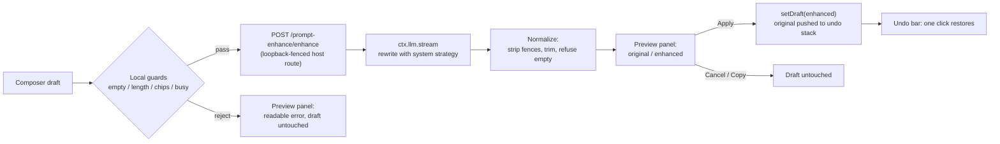

# dsh-prompt-refine

**Prompt enhancement for the [DeepSeek Harness](https://github.com/deepseek-ai) web GUI** — one click turns a rough composer draft into a well-structured prompt: explicit role and goal, executable steps, output format, acceptance criteria, and edge cases. Your intent is never changed, nothing is fabricated, and the original draft is always preserved.

English | [简体中文](./README.zh-CN.md)

---

## Why

Good agent prompts state *who the model should be*, *what to deliver*, *in what format*, and *how success is judged*. Most drafts don't. This plugin adds a **WorkBuddy-style "enhance" affordance** to the dsh composer: it sends your draft through a low-temperature rewrite pass (via the harness's own LLM service), shows the result next to the original, and lets you apply, copy, or discard it. Undo is one click away, and every failure path leaves your draft exactly as you typed it.

## Features

| | |
|---|---|
| ✨ **Composer button** | A small button in the input box's tool row (next to the send button), always at hand |
| 🔀 **Preview panel** | Original vs. enhanced side by side, with model name and elapsed time |
| ↩️ **One-click undo** | After applying, a quiet bar above the composer restores the original draft |
| ⌨️ **Shortcut** | Default `Ctrl+Alt+E`, fully configurable, acts on the composer you are working in |
| 💬 **`/enhance` command** | Rewrite any text from the slash-command plane; the result never enters model history |
| 🧠 **Model routing** | Settings pair → current session model → harness default model, in that order |
| 🔑 **Zero credential setup** | Calls ride the harness LLM service; keys come from the harness credential store |
| ⚙️ **Live settings** | Every knob (model override, temperature, budgets, system prompt, shortcut) hot-applies from Settings → 插件配置 |
| 🛡️ **Draft safety** | Empty, over-length, images-only, and command-chip inputs are rejected locally; upstream failures are mapped to readable messages; the draft is never mutated on failure |
| 🧬 **Prompt armor (opt-in)** | `armorEnabled` prepends your own text to the system prompt of every turn; the file applies on the next turn, and the same body from `dsh-purge` is never injected twice |
| 🚫 **No more refusals as results** | `rewriterArmor` tells the enhancement call it is a rewriter, not a reviewer; a real declination is retried once, then reported as `refused` with a "route this elsewhere" hint |

## How it works



The plugin is one npm package with two halves, following the dsh plugin conventions:

- **Host half** (`exports "."`, Node): registers the `prompt-enhance` settings section (schemastery — rendered automatically by the built-in plugin config page), the `POST /prompt-enhance/enhance` route on the shared webserver (loopback-fenced, body-capped), and the `/enhance` slash command. The model call goes through `ctx.llm.stream` with a normalized output pass — the same auxiliary-call discipline the harness applies to session titles: deadline + caller cancellation rechecked during and after the stream, terminal-finish validation, tool-call rejection.
- **Browser half** (`exports "./client"`): registers the enhance button into the `conversation.input.right` slot and the undo bar into `conversation.input.dock`, binds a live mirror of the settings namespace, and installs the global shortcut. All copy is localized (zh/en) through the harness locale system.

## Requirements

- `dsh >= 0.1.1-rc.2 < 0.3.0` — the range states what has actually been exercised, not an open-ended promise.
- Boot-verified on `0.1.1-rc.2`, `0.1.2-alpha.3`, `0.1.7-rc.2`, and `0.2.0-rc.2` (layer mounts, enhance route answers, client bundle builds; on alpha the plugin takes the newer `ctx.settings.installSection` registration path, and on `0.2.0-rc.2` it also passes the runtime's plugin-compatibility gate). The `0.2.0-rc.2` checks include the **dsh desktop application** — the environment this plugin is normally used in. On a `0.2.x` runtime expect some *other* plugins to disappear from the UI: the gate skips any bundle whose `peerDependencies` pin an older `@deepseek-ai/dsh-*` range (observed: `dshmarket`, `dsh-find-plugin`, `dsh-better-sidebar`). The harness has broken two APIs the plugin touches: `@deepseek-ai/dsh-settings` changed its registration entry between the two early lines, and from `0.1.5-rc.3` the settings service became `SettingsForms` (no synchronous `get`) while `dsh-agent-default-model` moved the harness default model behind its own `ctx.agentDefaultModel.currentSelection()` service. The plugin probes all three shapes at runtime and adapts, no configuration needed. On `0.2.0-rc.2` the workspace layer is confirmed live as well: the host log records `ctx=1 ws=<files>` on a real call.
- The range names `0.1.1-rc.2`–`0.1.x` prereleases and the `0.2.x` **releases**. In strict npm-semver terms a prerelease only satisfies a range whose comparator set names a prerelease of its own `major.minor.patch`, so the `0.2.x` prereleases this plugin is tested on — including `0.2.0-rc.2`, the desktop build it normally runs on — are admitted by checkers that evaluate the declaration with prereleases included (the plugin market's discovery check does), not by the range text alone. `dsh.engines` is advisory metadata read by the loader and the plugin manager: it states support, it does not gate loading, and on `0.2.0-rc.2` this plugin is mounted and enhancing today. A `0.3.x` is untested and therefore outside the range.
- Node `^22.19.0 || >=24.0.0` (for building from source)
- Browser peers `react` / `react-dom` (`^18.2.0`) come from the web shell's module registry. The host-half module `@deepseek-ai/dsh-llm` is a **runtime module supplied by the dsh host and is not installed from npm** (the `lib/` bundles keep every package import external), so it is declared as an *optional* peer: an install that does not provide it produces no warning, and the plugin reports a normal error at enhance time rather than failing to load.
- **Loopback-only and unauthenticated** — the host half serves the enhance route on your own dsh host and accepts it only from this machine (the loopback addresses `127.0.0.1` / `::1`). The route carries **no user authentication**: *any local process* can call it.
- **Single-process deployments only** — the concurrency cap and the per-minute rate limit are counted **in one host process's memory**. Multiple processes, a cluster, or several profiles mounting the plugin each count independently, so the global cap would be exceeded; the plugin ships no shared rate-limit store.

| | |
|---|---|
| dsh | `>= 0.1.1-rc.2 < 0.3.0` |
| Node | `^22.19.0 \|\| >=24.0.0` |
| Plugin | `0.2.x` |

## Install

From npm (recommended):

```bash
dsh plugin --profile web add dsh-prompt-refine
# restart dsh web
```

From GitHub (the built `lib/` is committed, so no local build happens):

```bash
dsh plugin --profile web add github:M-eang/dsh-prompt-refine
```

From a local checkout (for development — changes rebuild + restart take effect):

```bash
git clone https://github.com/M-eang/dsh-prompt-refine.git
cd dsh-prompt-refine && npm install && npm run build
dsh plugin --profile web add link:C:\path\to\dsh-prompt-refine
```

Uninstall:

```bash
dsh plugin --profile web remove dsh-prompt-refine
# check the profile's package.json `dsh.profile.bundles` array for a leftover
# "dsh-prompt-refine" row and remove it if present, then restart dsh web
```

## Usage

**Composer button / shortcut** — type (or leave) a draft, hit ✨ or `Ctrl+Alt+E`:

1. Local guards run first: empty drafts, over-length drafts (never auto-truncated — that would change your meaning), images-only drafts, and drafts containing command or file-reference chips are refused with a clear message. Chips are rejected because filling back would destroy them.
2. The preview panel opens with a cancellable spinner. Your draft stays untouched — the hint says so.
3. The result phase shows both texts side by side. **Apply** fills the enhanced text back and raises the undo bar; **Copy** puts it on the clipboard; **Cancel** (or `Esc`, or clicking the overlay) discards everything.
4. The undo bar sits above the composer: one click restores the original. If you keep typing after applying, the bar quietly retires itself so stale text can never overwrite newer edits. Undo entries live **only in the current page's memory** (up to 3 per session) — a page reload, a web restart, or a session switch clears them.

**`/enhance <text>`** — rewrite any text from the slash menu. The result renders in the command plane (copyable) and never enters the conversation history or the model's context; a rewrite that stopped at an output cap carries a "possibly incomplete" note underneath it. To enhance the *composer draft itself*, use the button or shortcut — the draft lives in the browser. Cancelling a running `/enhance` follows the harness command plane; if the client offers no cancel affordance, the call simply runs to completion or times out.

**Language consistency**: the strategy instructs the model to mirror the input language (Chinese in → Chinese out). This is a best-effort instruction, not a hard guarantee.

## Context and workspace

Every enhancement assembles two **evidence** layers (never instructions) ahead of the draft and hands them to the same model:

| Layer | Content | Source | Default budget |
|---|---|---|---|
| `<conversation_context>` | the recent `user`/`assistant` **text** of this session (tool calls, tool results and reasoning are excluded) | `Session.deriveMessages()`, spent newest-first | 12 turns / 8000 chars |
| `<workspace_context>` | the working directory's **structure** (depth-capped) plus **excerpts** of its highest-ranked files | `ctx.fs` (`resolve` / `listDir` / `readText`) over `session.header.cwd` | depth 2 / 60 entries / 30 files / 2500 chars per file / 12000 chars total |

The matching system-prompt rules are appended **only** for the layers that actually appear, and they all say the same thing: the context is evidence, the raw prompt wins. It may resolve pronouns, align with the established stack and real paths; it may never invent a file, directory, symbol or dependency, never treat what the excerpt does not show as known (use a `(TBD: …)` placeholder), and never restate the history or the excerpts in the output. A call without context keeps byte-identical instructions to older versions.

The scan is deliberately shallow and total-budgeted: vendor/build directories and binary/media extensions are skipped, obviously secret-bearing names (`.env*`, `*.key`, `*.pem`, `credentials*`, …) are skipped before any read, and text containing a NUL byte is dropped as binary. A huge repository therefore costs the same as a small one.

**Every failure degrades, never fails:** no session id, no working directory, no `fs` service, an unreadable root, empty history — each one falls back to the plain draft rewrite and is reported as `ctx=0 ws=0` on the host log line.

A scan is reused for **10 seconds**, keyed on the `fs` provider, the session, the root and the bounds, so a retry after a timeout does not re-read the same tree; a failed or empty scan is never remembered, and `workspaceAware = false` disables the layer and that cache together. When either layer contributed, the result carries `evidence: { history, workspace, files }` and the panel adds one quiet line — *Evidence: this session's recent conversation · workspace (5 file excerpts)* — so what left the machine with the draft is visible per call. An ungrounded call omits the field entirely, and a host older than it renders nothing.

A call that fails gets its own single-line entry, with one extra non-sensitive dimension so the failure can be diagnosed from the log alone:

```text
[prompt-enhance] 3f9c1d2a in=412 error=upstream reason=rate-limit 812ms
[prompt-enhance] 3f9c1d2a in=412 error=internal reason=no-llm-service 3ms
```

`reason=` is a closed-vocabulary classifier, never free text: the stable upstream reason (`max-tokens`, `context-window`, `rate-limit`, `auth`, `quota`, … — the same tokens the panel keys its fix hints by), the sanitized class of a host-side throw (`TypeError`, `abort`, `no-llm-service`, `unknown-finish`), or the error code itself when that is already the most specific fact (`timeout`, `unconfigured`). Any classifier that is not a plain identifier is logged as `unexpected`, so the provider's raw message, the prompt text, and the provider/model route stay out of the log entirely.

A successful call that stopped at an output cap marks its own line instead of failing — `… 812ms truncated=1 ok` — so a result that looks too short is explainable from the log alone.

## Configuration

Everything lives in the `prompt-enhance` settings namespace. On a pre-`0.2.x` runtime it is edited from the web GUI's **Settings → 插件配置** page. On `0.2.x` the host's settings service was removed, so this plugin contributes its own page to the **Plugins** panel instead: the row for `dsh-prompt-refine` grows a **Configure** control that opens `src/client/SettingsCard.tsx`. That page reads and writes the namespace through the manager's `configForms` seat, which is why it renders the host's own schema and effective values rather than a second copy of them, and a saved change applies to the very next call — no restart. It imports no other Client package: the official plugin-development guidance forbids loading `@deepseek-ai/dsh-client-ui-primitives` at runtime, so the controls are plain HTML styled with this plugin's own classes and the `--dsw-alias-*` theme tokens. Every enhancement is one billable LLM call: `maxOutputTokens` can bound its cost (the default `0` sends no cap of ours and leaves the maximum to the harness/provider), and the host-side concurrency/rate caps bound how often calls can be made.

| Field | Default | Description |
|---|---|---|
| `enabled` | `true` | Master switch; off hides the button and disables every trigger |
| `provider` + `model` | empty | Explicit route override; must be filled as a **pair** (or both empty to follow the current session model) |
| `temperature` | `0.3` | Low temperature keeps the rewrite faithful to the original |
| `mode` | `standard` | Enhancement mode — seven output shapes under the same hard rules. `standard` **equals the historical behavior** (no extra discipline, no output cap of our own); `concise` clarifies without padding (2000 tokens); `spec` a sectioned, testable deliverable specification (8000); `engineering` a work order someone can build from — objective, context, constraints, interfaces, ordered steps, acceptance (8000); `colloquial` dictated or term-stacked text turned into plain natural prose, no headings and no bullets (2000); `research` a claim laid out as what is known, what is assumed, the alternatives and the criteria that decide (6000); `creative` intent, audience, tone, hard constraints and several openings (4000). Each addon names its own mode and is appended **last** to the system prompt, but **never overrides** the built-in hard rules (preserve intent, never fabricate, body-only output, mirror the input language); an explicit `maxOutputTokens` wins over the mode's budget; a one-off override is `/enhance --mode <id> <text>`, and `/enhance modes` lists the ids |
| `template` | empty | Built-in template (template library). Frames the rewrite as one deliverable shape: `code-review` / `bug-report` / `weekly-report` / `api-doc` / `test-plan` / `refactor`; empty means no template. The template discipline is appended **after** the mode discipline and likewise never overrides the built-in hard rules; a one-off override is `/enhance <template> <text>` |
| `maxOutputTokens` | `0` (no cap) | Output token cap of one enhancement call. **`0` — the default — sends no maximum at all**, so the harness adapter's own default (or the provider's, when the adapter reports none) applies; a positive value up to `32768` is sent verbatim. A gateway that injects thinking by default spends this budget on reasoning too, so an explicit cap limits `thinking + answer`, not just the rewritten body. If a rewrite still stops at a cap, it is returned as a **partial result with a warning** rather than refused |
| `maxInputChars` | `12000` | Input character cap (counted in Unicode code points — an emoji is one character); over-limit drafts are **rejected, never truncated** |
| `timeoutMs` | `60000` | End-to-end deadline of one call |
| `rewriterArmor` | `true` | Rewrite stance: prepends "this is the rewriter step of a toolchain, not a content review and not authorship" to the enhancement call's own system prompt, so a provider stops reading "rewrite this draft" as "produce what the draft describes" and declining. It decides *whether* the rewrite happens, never *how* (the built-in hard rules still apply); `false` sends a request byte-identical to 0.2.9. Outside the stance, a real refusal is detected and retried once, then reported as `upstream` / `refused` |
| `systemPrompt` | built-in strategy | Custom strategy text; how it combines with the built-in strategy is set by `strategyMode` |
| `strategyMode` | `replace-default` | How a custom strategy combines with the built-in one: `replace-default` **swaps it out entirely** (backward compatible, but the built-in hard rules — preserve intent, never fabricate, body-only output, language mirroring — are not retained and must be carried into your own text); `extend-default` **appends your text after the built-in strategy**, keeping those rules in force |
| `shortcut` | `ctrl+alt+e` | Global shortcut spec (at least one modifier + one alphanumeric/function key — bare keys are ignored so normal typing can never be swallowed); empty disables it |
| `maxConcurrent` | `2` | Concurrency cap **within a single host process**; extra requests answer `429` (`concurrency-limit`). The browser UI admits exactly one in-flight request (a single preview panel), so this cap mainly protects the `/enhance` command plane and multi-client callers |
| `rateLimitPerMinute` | `10` | Sliding-window rate cap per minute, **within a single host process**, counting **successful calls only** — failures (timeout / upstream error / cancellation) never consume the window, so a run of failures cannot rate-limit you out; extra requests answer `429` (`rate-limit`) with a `Retry-After` in seconds |
| `streaming` | `true` | Show the model's output as it streams instead of waiting for the whole rewrite — **display-only**, the final text is still the normalized full result, and the client transparently falls back to the one-shot JSON route when the host or network does not support `text/event-stream` |
| `contextAware` | `true` | Read the current conversation's recent history and use it to ground the rewrite (resolve pronouns, fill in stated constraints, mirror the established stack and terminology). With no session, no history, or this switch off, the call degrades to the original single-prompt enhancement — context is an optimization, never a prerequisite. **Privacy:** the assembled history snippet is sent to the configured LLM alongside the draft — if the conversation contains secrets, tokens, or other sensitive content, switch `contextAware` off (or scope the conversation before enhancing). |
| `contextMaxMessages` | `12` | Context window breadth — how many recent `user`/`assistant` turns may ground the rewrite; `0` admits none |
| `contextMaxChars` | `8000` | Context window depth — character budget of the assembled history snippet, spent newest-first so the most recent turns win when the budget is tight; `0` admits none |
| `workspaceAware` | `true` | **Workspace awareness:** read the session's working directory (directory listing + bounded file excerpts) and use it to name the real files, directories and stack. With no working directory, no `fs` service, or an unreadable root, the call degrades to history + draft — the same optimization-not-prerequisite contract. **Privacy:** the excerpts are sent to the configured LLM alongside the draft; obviously secret-bearing names (`.env*`, `*.key`, `*.pem`, `credentials*`, …) are skipped before a single byte is read, but ordinary source files are still shared. |
| `workspaceRoot` | empty | Absolute directory to scan instead of the session's own working directory (`session.header.cwd`) |
| `workspaceMaxDepth` | `2` | Directory nesting depth admitted by the scan (the root counts as depth 1) |
| `workspaceTreeMax` | `60` | Maximum entries listed in the directory-structure section; `0` lists no structure |
| `workspaceMaxFiles` | `30` | Maximum files whose excerpt is included; `0` reads no file content |
| `workspaceMaxFileChars` | `2500` | Character cap of one file excerpt (cut excerpts are marked) |
| `workspaceMaxChars` | `12000` | Character cap of all file excerpts together, spent by file rank (README → manifest/config → docs → source) |
| `provider` + `model` values | — | Match the harness settings: each key under `llm-pi-ai.providers` (e.g. `zhipu`, `muyuu`) is a provider and each `models[].id` under it (e.g. `glm-5.3-flash`) is a model. Example pair: `provider: zhipu` + `model: glm-5.3-flash` |

**Model routing precedence:** explicit settings pair → the route recorded in the current session's request header → the harness-wide default model (`agent-default-model`). If none of them names a route (e.g. a fresh session with no default model), the plugin fails with an actionable message instead of guessing.

## The built-in enhancement strategy

The default system prompt instructs the model to be a prompt-rewriting expert and to apply what the draft actually needs:

1. **Role and goal** — state who the assistant acts as and what the deliverable is.
2. **Context and constraints** — add only what the draft implies; never invent facts, data, names, or requirements.
3. **Steps** — break vague or multi-part requests into numbered, executable steps.
4. **Output format** — specify structure, language, length, and style where implied.
5. **Acceptance criteria** — state how to recognize a correct result.
6. **Boundary conditions** — list edge cases and what to do when information is missing.

Hard rules: preserve intent exactly (never remove, alter, or contradict user information); never fabricate — insert an explicit placeholder like `(待补充：…)` / `(TBD: …)` for unknown details; keep the scope unchanged; output **only** the rewritten body (no explanations, fences, or pleasantries); mirror the input language; stay within roughly 1–3× the original length; lightly polish already-well-formed prompts instead of inflating them.

Set `systemPrompt` in the settings to use your own strategy; `strategyMode` decides how it combines. The default `replace-default` is a **complete replacement** — the built-in safety constraints (preserve intent, never fabricate, body-only output, mirror the input language, treat the framed draft as data) are not retained automatically, so your own strategy must include them. Switching to `extend-default` appends your text after the built-in strategy instead, keeping those rules in force.

## Enhancement modes

`mode` decides the **shape of the output** and is orthogonal to `systemPrompt`/`strategyMode`: those pick *which* strategy, this picks *how hard*.

| Mode | What it does | Its own output budget |
|---|---|---|
| `standard` (default) | Adds nothing: the prompt and the request body stay byte-identical to earlier versions | none (follows `maxOutputTokens`, default 0 = uncapped) |
| `concise` | Clarifies without padding; a one-paragraph prompt stays one paragraph | 2000 tokens |
| `spec` | Produces sections for goal / inputs / constraints / deliverable format / acceptance criteria / boundary cases, preferably as numbered, testable statements | 8000 tokens |

The mode discipline is appended **last** to the system prompt (more specific than the built-in strategy or your custom text) but never overrides the built-in hard rules: never fabricate, body-only output, mirror the input language. An explicit positive `maxOutputTokens` **wins over** the mode's own budget.

**A leading slash command is preserved verbatim**: when the draft is `/logs 200` followed by prose, only the prose is sent to the model and the command line is re-attached to the result; a draft that is nothing but a command triggers no model call at all and comes back unchanged. The rule is deterministic (see `src/shared/slash.ts`), so a path with a second slash such as `/home/user/a.txt` is never mistaken for a command.

## Template library

`template` is orthogonal to `mode` and **composes with it**: the mode picks how hard the rewrite works, the template picks the shape it delivers. The template discipline is appended **after** the mode discipline and never overrides the built-in hard rules — every template carries its own "never invent" requirement.

| Template | Frames the rewrite as |
|---|---|
| `code-review` | A code review: what changed, what to focus on (correctness, boundaries, maintainability), findings one per item with the evidence behind each |
| `bug-report` | A bug report: symptom, reproduction steps, expected, actual, environment/version, which evidence to attach |
| `weekly-report` | A weekly report: period, workstreams, completed, slipped, blockers, next steps |
| `api-doc` | API documentation: signature, parameters with types and defaults, return value, errors, one usage example |
| `test-plan` | A test plan: scope, cases (input + expected result), boundary and failure cases, how the outcome is verified |
| `refactor` | A refactoring brief: current structure, target structure, constraints (behaviour and public interfaces unchanged), how correctness is verified afterwards |

The set is deliberately **closed**: a template that only rewords the request would be noise in the settings page, and an open-ended "custom template" would duplicate `systemPrompt`. Leave it empty for no template. For a one-off override write `/enhance <template> <text>` (for example `/enhance code-review take a look at this change`); `/enhance templates` lists them all.

## Enhancement history

Below the result, the panel keeps the **last 10 rewrites of this session** (up to 40 sessions per page, evicted least-recently-written first). Each entry can be loaded back into the composer, and the whole list cleared. It is a different affordance from the undo bar: the undo bar holds only the most recent apply and is dismissed by the next one, while the history is the way back to a rewrite you want to look at again.

The history lives in **browser memory only**: a page refresh clears it, nothing is written to disk, and nothing is sent anywhere. Only the original draft and the result the panel already showed are kept, labelled with the mode and template that produced them.

## Prompt armor

`armorEnabled` (off by default) prepends an operator-written block to the system prompt of **every** turn, above every section the host assembles. It is the prompt-level half of what `dsh-purge` calls 破甲, ported without any of the parts that rewrite the installed application: no patches to `app.asar`, no approval or sandbox changes, no extra tools. What it changes is what the model is told about itself, nothing about what the runtime will let it do.

The body is resolved **file → inline → built-in**: `armorFile` wins while that file exists and is non-empty (it is **empty by default**, so nothing is read from disk), `armorText` is next, and with both unset the plugin injects its own `DEFAULT_ARMOR_PROMPT` from `src/prompts.ts` — the shipped armour lives in code, and clearing both fields is a reset to it rather than a silent disable. `~` and `${DSH_HOME}` expand in `armorFile`; the file is cached by mtime, so editing it takes effect on the next turn without a restart. Set `armorFile` to `~/.dsh/prompt-inject.md` (the file `dsh-purge` reads) to drive the text from disk instead.

Three properties make it safe to leave on:

- **Escaped interpolation.** `{{model}}` and `{{provider}}` are registered by the harness and pass through; every other `{{variable}}` is rewritten to `{ {variable} }`. An unregistered `{{cwd}}` is a hard prompt-assembly failure on this runtime, and one stray token in an operator file must not cost the turn (`dsh-purge` 1.4.1 exists because of exactly that).
- **Two registration paths, one block.** The section is registered through `ctx.systemPrompt.section()` when the host exposes that seat, and through the `system-prompt/assemble` event otherwise; both dedupe on the section name, so belt-and-braces cannot send it twice.
- **No double injection.** If another plugin already injected the identical body verbatim (same file, whitespace-insensitive comparison), the block is left alone instead of being duplicated — running this alongside `dsh-purge` costs nothing.

`armorOrder` (default `-100000`) is the section `order`, i.e. how far ahead of the built-in sections it sorts. A downstream listener throwing inside the assemble waterfall is caught: the turn falls back to the upstream assembly rather than failing.

## Host references

**`@file` and `/skill` picks are protected, not preserved by luck.** A draft is a single string in the composer, and both reference sources serialise to their literal text — the `@` source's codec returns the ref unchanged, and the `/` skill source inserts `/name `. The model therefore sees `@src/app.ts` as ordinary prose, and a rewrite will translate it, punctuate it, or reword `/code-review` like any other word; the chip stops resolving and the pick is lost.

The fix is to make the reference unreachable rather than to hope it survives:

- Before the call, every reference in the body is swapped for a placeholder `⟦n⟧` (`src/shared/refs.ts`); after the call it is written back verbatim.
- The system prompt gains a short rules block (`withRefRules`) **only when the draft carried references**, so a reference-free request stays byte-identical: keep the tokens, same number and order, invent no paths, do not explain what a placeholder "really is".
- A reference the model still loses is re-appended to the end of the result rather than dropped, and the response carries `refs: { total, restored, missing }`.

Recognition is boundary-aware: `dev@example.com`, `https://host/a/b`, `and/or` and absolute paths are not references; `@"a path with spaces.md"` is taken whole; in `看@src/app.ts哪里慢` the path ends where the prose resumes and 「哪里慢」 stays in the sentence. A leading `/command` line is still handled by the slash prefix, before this runs.

The anchor/evidence pass runs on the placeholder body, so a reference is never mistaken for a literal fact to verify.

Nothing needs removing first: a draft containing `@` picks or a leading `/` command is enhanced like any other. The one caveat is the write-back — the host's only draft writer is `setDraft`, which clears the composer and re-inserts plain text — so applying a result turns a chip into its literal `@path` / `/name` text. The path still resolves and the command still works when you send, but the chip highlight and click-to-open are gone, and a `/name` first line has to be re-picked to count as a claim. The result panel says this before you apply, and only when the draft actually had chips.

## Rewrite stance and refusal handling

**The enhancement call only has to *rewrite*; it is not being asked to *write*.** Models still read "turn this draft into a clear prompt" as "produce the content the draft describes", and answer with a declination — "I can't help with this… if what you actually want is…". That used to come back as the enhanced prompt. Two layers now handle it:

- **`rewriterArmor` (on by default)** prepends a stance block to this call's own system prompt: a rewriter in a toolchain, not a content reviewer and not the author; no subject-matter judgement, no policy prose, no "here is a safer version". It decides *whether* the rewrite happens; the built-in strategy still decides *how* (never fabricate, body only, mirror the input language are untouched). Set it to `false` for a request byte-identical to 0.2.9.
- **Refusal detection + one retry.** A reply counts as a refusal when a declination phrase appears in its head **and** it carries no prompt scaffolding (headings, bullets, numbered steps, labels like `Role/Requirements/Output format`, a `You are…` role assignment). On a hit the call is repeated once with a harsher correction appended; a second refusal is terminal as `upstream` / `reason=refused` with a "route this elsewhere" hint — never a result. One retry, never a loop.

The detector is a heuristic: a false positive costs one extra call, it never replaces a result you have not seen. A model that content-reviews regardless of framing can only be fixed by pointing `provider` / `model` at one that does not (local or self-hosted).

## Error handling & edge cases

| Case | Behavior |
|---|---|
| Empty / whitespace / invisible-only draft | Local refusal: "input box is empty" |
| Draft over `maxInputChars` | Rejected locally and at the route with exact counts; **no auto-truncation** |
| Images attached but no text | Refused: text-only feature |
| Command or file-reference chips in the draft | Refused: fill-back would destroy the chips |
| Submitting / busy phase or a request already in flight | Refused with "try again in a moment" |
| Per-minute cap exceeded | `429` (`rate-limit`) with a `Retry-After` in seconds; the host message names the exact wait. The window counts successful calls only — failures do not consume it |
| Concurrency cap full | `429` (`concurrency-limit`), no `Retry-After` — a slot frees whenever an in-flight call settles |
| Upstream model failure | Stable codes mapped to readable hints: `AUTH` → check API key, `RATE_LIMIT` → retry later, `QUOTA_EXCEEDED` → check balance, `CONTEXT_WINDOW_EXCEEDED` → shorten input, `NO_ADAPTER`/unconfigured → configure a model |
| Upstream model declines (read the draft as a generation task) | One automatic retry; a second declination is `upstream` / `reason=refused` with a "route this elsewhere" hint — a refusal is never returned as a result |
| Output reaches an output cap (yours or the provider's) | **Not a failure**: the partial rewrite is returned and the panel warns above it (`truncated: true` on the wire, `truncated=1` on the host log line). Only a cap hit with nothing readable left falls back to the refusal hint |
| Model returns empty / fence-wrapped / tool-call output | Normalized (fences stripped) or refused; retryable |
| Timeout | `504`-mapped message with the configured seconds; retryable |
| Host-side failure (`ctx.llm` absent, invalid `prompt-enhance` settings section, unexpected throw) | `internal` — `500` for an invalid settings section, `502` otherwise; retryable, and the draft is untouched |
| Browser tab closed mid-flight | The host route detects the disconnect and aborts the model call |
| Session switch | Panel state, undo stack, and shortcut targeting are per-session; switching closes the panel and clears its undo entries |

Every failure surfaces inside the plugin's own panel; the composer draft is never modified by a failed call, so manual input continues undisturbed.

## Error codes & localization

The host route answers structured errors of the shape `{ code, message?, params? }`: the browser renders its localized primary line from `code` + `params` using the current language dictionary, and `message` — when present — is an optional diagnostic detail (the provider's raw failure text, a config error) shown verbatim beneath the primary line. A routed refusal carries no prose at all: it names a `params.reason` and the browser half supplies the copy (`content-type`, `body-too-large`, `invalid-json`, `invalid-body`, `disabled`). Failures the browser half originates itself (an unreachable host, an unparsable envelope, a cancelled call, a stream that closed early) name a dictionary `detailKey` for the same reason. The `/enhance` command plane has no locale dictionary; a host-side renderer of the same errors produces the Chinese text directly.

| Error code | HTTP status | Browser primary copy (dictionary key) | Params |
|---|---|---|---|
| `rejected` | 403 / 413 / 415 / 422 | generic `error.rejected`; with `{ reason }` its own line (`content-type` / `body-too-large` / `invalid-json` / `invalid-body` / `disabled`); with `{ count, max }` it reuses `error.tooLong` | over-length input: `{ count, max }`; routed refusal: `{ reason }` |
| `rate-limit` | 429 | `error.rateLimit` | `{ limit, retryAfterSeconds }` |
| `concurrency-limit` | 429 | `error.concurrencyLimit` | `{ max }` |
| `timeout` | 504 | `error.timeout` | `{ seconds }` |
| `unconfigured` | 409 | `error.unconfigured` | — |
| `upstream` | 502 | generic `error.upstream`; with `reason` it uses `error.upstream.{reason}` (`auth` / `invalidCredential` / `rateLimit` / `quota` / `empty` / `contextWindow` / `toolCall` / `maxTokens` / `refused`) | `{ reason }` |
| `internal` | 403 / 404 / 405 / 500 / 502 | `error.internal` | — |

The `internal` row carries the route's own refusals as well, because they answer with that code rather than inventing one: `403` for a request that is not from loopback (including one carrying `Forwarded` / `X-Forwarded-For`, which only a proxy adds), `404` for a path under the `prompt-enhance` prefix that is not one of the two endpoints, and `405` for a method other than `POST`. Their `message` detail names the actual cause (`forbidden: loopback-only`, `not found`, `only POST is allowed`) — machine-readable English, and unreachable from this plugin's own page, since a same-origin browser POST cannot fail those guards. Everything else is a real host-side failure: `500` for an invalid settings section, `502` for a missing `llm` service or any unexpected error. The invalid-section case is the one detail line that stays untranslated on purpose — which invariant failed is only known to the settings validator, and the plugin's settings descriptions are Chinese at the source.

## Troubleshooting

**Button missing / shortcut dead**
Settings → 插件配置 → `prompt-enhance` section: is `enabled` true? Is the plugin installed (`dsh plugin --profile web list`) and `dsh web` restarted? Any apply error in the browser console?

**"No model resolved for the enhancement"**
Routing follows settings pair → session model → harness default; if all three are empty there is nothing to call. Pair `provider`/`model` in the settings, or send a message in the current session first so it carries a model route. Check the `agent-default-model` settings section.

**Authentication failures**
The `message` detail line carries the concrete cause (e.g. 401). Check the provider's API key in the harness credential store; quota/balance problems surface as the `quota` hint.

**Rate-limited (429) right after a run of failures**
Should not happen — the window counts successes only. If it still does, check whether several profiles/processes are mounted (each counts independently and stacks up) or whether `rateLimitPerMinute` is set too low.

**Poor rewrites (fabrication, dropped requirements, broken formatting)**
With `strategyMode` set to `replace-default`, a custom `systemPrompt` replaces the built-in strategy entirely — its hard rules (never fabricate, body-only output, mirror the input language) are not retained automatically; carry them into your own text or switch to `extend-default`.

**Behavior changed after upgrading**
Since 0.1.6 the host no longer sends Chinese primary-line copy: the browser localizes errors by code (`message` is now only a diagnostic detail), and the `rate-limit` window counts successful calls only. No configuration change needed.

## Security model

The enhance route is served by your own dsh host and reachable **only from this machine**:

- **Socket fence** — requests from non-loopback addresses are refused (`127.0.0.1` / `::1` only). The unauthenticated premise this implies is stated in [Requirements](#requirements): *any local process* can call the route.
- **Host allowlist** — the route also validates the `Host` header against `localhost` / `127.0.0.1` / `[::1]`, which defeats DNS-rebinding (a rebound attacker domain keeps the loopback socket address but carries the attacker's hostname and is refused). Responses are `cache-control: no-store`.
- **Abuse caps** — an `Origin` gate refuses browser calls from non-local pages, and the route enforces a concurrency cap (`maxConcurrent`, default 2) and a per-minute rate limit (`rateLimitPerMinute`, default 10), answering `429` beyond either. Both counters live in a single host process's memory — the single-process premise is in [Requirements](#requirements) — so multiple processes, a cluster, or several profiles mounting the plugin each count independently and the global cap would be exceeded.
- **Proxy rejection** — requests carrying `X-Forwarded-For` / `Forwarded` headers are refused outright: those headers only exist when a proxy is in the path, which the trust model does not cover.
- **Request-level timeouts are the host's and Node's job** — the plugin bounds the body size (including a Content-Length fast reject) and the per-call `timeoutMs`; connection-level timeouts (headers / request timeout / keep-alive) are server-level settings on the shared `http.Server` that a prefix route must not touch, so they fall to the host and Node's defaults (60 s headers / 300 s request).
- **Not for reverse-proxy exposure** — if you put dsh web behind a proxy that listens on the LAN, external callers appear as loopback to the route and the fence is moot. Do not expose a proxied host without adding your own authentication at the proxy.
- **Prompt-injection boundary** — the draft is framed between `<raw_prompt>` tags, literal closing tags inside the draft are neutralized, and the strategy prompt treats the framed text as pure data. This lowers the risk of simple tag-escape; prompt-based boundaries are best-effort, not a guarantee. Enhancements run with your own credentials and the result is only ever shown back to you.
- **Workspace data sharing** — when `workspaceAware` is on (default), bounded excerpts of the session's working directory are sent to the configured LLM alongside the draft, exactly like the conversation history. Secret-shaped names are skipped before any read, but ordinary source and documentation files are not: point `workspaceRoot` at a narrower directory, lower the budgets, or switch `workspaceAware` off when the working directory must not leave the machine. The `evidence` line above a result names the layers that were used, so the boundary is visible without opening the settings.
- **Conversation-context data sharing** — when `contextAware` is on (default), the plugin assembles the recent `user`/`assistant` history of the current session (capped by `contextMaxMessages` / `contextMaxChars`) and sends it to the configured LLM alongside the draft. That history may carry secrets the user typed earlier in the session — API keys, tokens, internal hostnames, customer names — which the LLM provider will see verbatim. Treat the switch as the privacy boundary: turn it off (or end the session and start a fresh one before enhancing) when the conversation should not leave the machine. The hard rules on context use in the strategy prompt forbid introducing facts the raw prompt does not support, but they cannot un-share what has already been sent. The `evidence` line above a result reports whether this layer was used.

## Architecture

```
src/
├── index.ts            host apply(): settings section + route + command
├── config.ts           schemastery schema + resolution (paired route validation)
├── prompts.ts          built-in strategy system prompt + <raw_prompt> framing
├── enhancer.ts         the ctx.llm auxiliary call (route resolution, deadline
│                       racing, finish validation, structured errors + host render)
├── enhance-routes.ts   POST /prompt-enhance/enhance + /enhance-stream (loopback
│                       fence, body cap, admission gate)
├── enhance-command.ts  /enhance slash command (host command registry)
├── orchestrate.ts      shared route resolution + context assembly for both entries
├── context.ts          bounded, neutralized <conversation_context> snippet
├── workspace.ts        bounded, secret-skipping <workspace_context> scan
├── loopback.ts         127.0.0.1/::1 fence for the route
├── http.ts             bounded JSON body reader / writer
├── sse.ts              backpressure-aware SSE frame writer
├── shared/             wire protocol types, input checks, output normalization
│   ├── modes.ts        enhancement modes (standard/concise/spec): discipline + budget
│   ├── templates.ts    template library (code-review/bug-report/…): deliverable-shape discipline
│   ├── slash.ts        deterministic split / re-attach of a leading slash command
│   └── sanitize.ts     second line of defense (wrapping quotes, meta lines, courtesy)
│                       (imported by both halves)
└── client/             browser half
    ├── index.tsx       slots registration + settings mirror + shortcut listener
    ├── EnhanceButton   conversation.input.right entry: guards + call orchestration
    ├── ResultPanel     overlay panel: compare / apply / copy / cancel / retry
    ├── UndoBar         conversation.input.dock entry: restore affordance
    ├── ui-state.ts     external store shared by components (panel, undo, sessions)
    ├── enhance-client  fetch client with abort + typed errors (SSE + one-shot)
    ├── undo-stack.ts   per-session LIFO (depth 3, global cap 60, LRU eviction)
    ├── history.ts      per-session enhancement history (10 per session, 40 sessions, LRU eviction)
    ├── session-key.ts  per-composer UI key (host sessionId, else stable fallback)
    ├── shortcut.ts     pure combo parsing / matching
    ├── settings.ts     client mirror of the settings namespace
    ├── locales.ts      zh + en dictionaries (harness locale namespace)
    └── styles.ts       self-injected stylesheet (dsh-pe- prefixed classes)
```

Build outputs: `lib/index.js` (host half, ESM, package imports kept external) and `lib/client.js` (browser half bundled to CJS inside the `window.__ModuleLoader__.load({ id, factory })` envelope the dsh web shell expects). Both are committed so GitHub installs need no build step; CI fails if `lib/` drifts from `src/`.

## Development

Daily debug loop (link install + watch): install once via `dsh plugin --profile web add link:...`, run `npm run watch`, and restart `dsh web` after host-half changes — see [CONTRIBUTING.md](./CONTRIBUTING.md).

```bash
npm install
npm run typecheck     # tsc --noEmit
npm test              # unit + real-http + component suites
npm run build         # typecheck + both halves
npm run watch         # esbuild watch for both halves
```

**Test coverage:** input validation, output normalization, the enhancer against stubbed `ctx.llm` streams, a real-`node:http` route suite (loopback/Host fence, disconnect abort, structured error envelopes, every routed refusal reason, the SSE end-to-end path, the evidence report of a grounded call), the workspace scan (bounds, truncation, secret-name and binary gates, the visit cap, its test seam) and the 10-second scan cache, conversation-context selection, prompt framing, config resolution, the undo stack, shortcut parsing, client settings (including the mirror-vs-host-default check), the locale tables (key-set parity, upstream/rejection/detail mappings), and React component tests locking the enhance → apply → undo flow (guards, stale marking, diverged-draft undo semantics, localized refusal and detail lines, the evidence line). `npm run preflight` then loads the committed `lib/index.js` against a real filesystem to check that the built host half still grounds a call without reading a secret-shaped file.

**Release process (maintainers):**

> **本地线（2026-11-04，ADR-005）：本仓库不再发布 npm。** 下面的 `git push` 与 `npm publish` 两步不适用；唯一有效的收尾是 `npm run build && npm test && npm run preflight`，保证 `lib/` 与 `src/` 同步。版本号停在 `0.2.10 (本地线)`——npm 上 `dsh-prompt-refine` 的 `latest` 是 `0.3.4`，那是另一条分叉线（无 `armor.ts`、无 `shared/refusal.ts`），不合并、不对齐。历史流程保留如下。

```bash
npm version patch   # or minor / major — bumps package.json and tags
npm run build       # make lib/ match src/
npm test && npm run preflight   # unit suites + the built-bundle smoke test
git push --follow-tags
npm publish         # with 2FA OTP, or a granular token with "bypass 2FA" checked
```

When `package.json` already holds the version being released — as `0.2.8` did, because the number was never published — skip `npm version` and tag that commit instead (`git tag v0.2.8 && git push --follow-tags`); running it anyway would silently publish the next number instead.

CI runs typecheck + tests + build on every push/PR, then the built-bundle preflight, on Node `22.19` and `24`, and rejects merges where `lib/` differs from the committed build.

## FAQ

**Why is my draft rejected when it contains `/commands` or `@references`?**
The fill-back writes plain text via `inputActions.setDraft`, which would destroy the chips. Remove them, enhance, then re-insert.

Update (0.2.8 onward): a **leading** `/<command>` no longer needs removing — enhance excludes the command line from the rewrite and re-attaches it verbatim (a draft holding nothing but a command triggers no model call and is returned unchanged). `@references` still have to be removed first.

**Why isn't over-length input auto-truncated?**
Truncation silently changes your meaning — the plugin refuses and shows the exact counts instead.

**Can I pin a specific model?**
Fill `provider` and `model` **as a pair** in the settings (e.g. your harness-configured provider route). Leave both empty to follow the current session's model.

**Where does my draft go?**
Browser → your own dsh host over a loopback-only route → the harness LLM service → the configured model provider. Nothing is sent anywhere else, and the enhancement never enters the session's model history.

**Does it work with the official DeepSeek route?**
Yes — it rides `ctx.llm`, so any provider the harness serves (DeepSeek official, OpenAI-compatible gateways) works.

## Manual smoke checklist

After installing and restarting `dsh web`:

1. Settings → 插件配置 shows the `prompt-enhance` section.
2. The ✨ button sits next to the send button; `Ctrl+Alt+E` triggers the same flow.
3. Empty input → refusal panel; a valid draft → preview with model info; Apply fills back; Undo restores; Copy works.
4. `/enhance <text>` renders a copyable result without touching model history.
5. All three model routes work: pinned settings pair, a session's model, and the harness default.

## Acknowledgments

Plugin structure, the loopback fence, and the settings-section pattern follow the conventions established by the dsh plugin family — in particular [`@linxin666/dsh-tool-describe-image`](https://www.npmjs.com/package/@linxin666/dsh-tool-describe-image).

## License

[Apache-2.0](./LICENSE)
