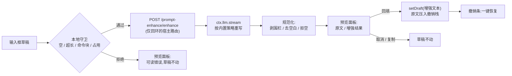

# dsh-prompt-refine

**DeepSeek Harness Web GUI 的「提示词增强」插件** —— 一键把输入框里的草稿改写为结构化提示词:明确的角色与目标、可执行步骤、输出格式、验收标准、边界条件。不改变原意、不凭空编造需求,原文始终保留。

[English](./README.md) | 简体中文

---

## 为什么需要它

好的智能体提示词会讲清*让模型扮演谁*、*交付什么*、*以什么格式*、*怎样算合格*——而大多数草稿不会。本插件给 dsh 输入框加上 WorkBuddy 风格的「增强」入口:草稿经低温重写(走 harness 自带的 LLM 服务),结果与原文并排对比,你可以回填、复制或丢弃。撤销只需一键,且**任何失败路径都不会改动你输入的内容**。

## 功能一览

| | |
|---|---|
| ✨ **输入框按钮** | 工具栏内发送键旁的小按钮,随手可及 |
| 🔀 **对比预览面板** | 原文与增强结果左右并排,附模型名与耗时 |
| ↩️ **一键撤销** | 回填后输入框上方出现撤销条,一键恢复原文 |
| ⌨️ **快捷键** | 默认 `Ctrl+Alt+E` 可配置,作用于你正在使用的输入框 |
| 💬 **`/enhance` 命令** | 斜杠面板直接改写任意文本;结果不进入模型历史 |
| 🧠 **模型路由** | 设置成对覆盖 → 当前会话模型 → 全局默认模型,依次回退 |
| 🔑 **零凭据配置** | 调用走 harness LLM 服务,密钥来自 harness 凭据存储 |
| ⚙️ **配置热生效** | 模型覆盖、温度、预算、系统提示词、快捷键,全部在 设置 → 插件配置 即改即用 |
| 🛡️ **草稿安全** | 空输入、超长、仅图片、含命令块在本地拦截;上游失败映射为可读提示;失败绝不改动草稿 |
| 🧬 **提示词破甲(可选)** | `armorEnabled` 打开后,把你写的一段文本插到每轮系统提示词最前面;文件即改即生效,与 `dsh-purge` 同源不重复注入 |
| 🚫 **拒答不再冒充结果** | `rewriterArmor` 声明「这是改写环节,不是内容审查」;真的拒答会自动重试一次,仍不行就报 `refused` 并提示换模型 |

## 工作原理



插件是单个 npm 包、双半区结构,完全遵循 dsh 插件规范:

- **宿主半区**(`exports "."`,Node):注册 `prompt-enhance` 设置节(schemastery,由内置插件配置页自动渲染)、共享 webserver 上的 `POST /prompt-enhance/enhance` 路由(仅回环、限长),以及 `/enhance` 斜杠命令。模型调用走 `ctx.llm.stream` 并做规范化处理——与 harness 对会话标题相同的辅助调用纪律:超时与调用方取消在流过程中和结束后复查、终结 finish 校验、拒绝工具调用。
- **浏览器半区**(`exports "./client"`):把增强按钮注册进 `conversation.input.right` 插槽、撤销条注册进 `conversation.input.dock` 插槽,绑定设置命名空间的实时镜像,并安装全局快捷键。全部文案经 harness locale 系统提供中英双语。

## 环境要求

- `dsh >= 0.1.1-rc.2 < 0.3.0` —— 这个区间表示**实际验证过的范围**,而不是无限期的承诺。
- 实测环境:`0.1.1-rc.2`、`0.1.2-alpha.3`、`0.1.7-rc.2`、`0.2.0-rc.2` 均已 boot 验证(插件层挂载、增强路由应答、客户端 bundle 构建通过;alpha 上走新版 `ctx.settings.installSection` 注册路径,`0.2.0-rc.2` 上还通过了运行时的插件兼容性闸门)。其中 `0.2.0-rc.2` 的验证包含 **dsh 桌面应用**——也就是本插件日常实际运行的环境。在 `0.2.x` 运行时上,可能会发现**别的**插件从界面消失:凡 `peerDependencies` 把 `@deepseek-ai/dsh-*` 锁在旧区间的 bundle 都会被闸门跳过(实测被跳过的是 `dshmarket`、`dsh-find-plugin`、`dsh-better-sidebar`)。宿主在插件用到的两处 API 上做过破坏性变更:`@deepseek-ai/dsh-settings` 的注册入口在两条早期版本线之间变了;`0.1.5-rc.3` 起 settings 服务改为 `SettingsForms`(不再有同步 `get`),同时 `dsh-agent-default-model` 把全局默认模型收进了自己的 `ctx.agentDefaultModel.currentSelection()` 服务。插件对三种形态均做运行时探测并自动适配,无需配置。在 `0.2.0-rc.2` 上工作区层同样确认实机生效:真实调用的宿主日志会记录 `ctx=1 ws=<文件数>`。
- 该区间命名的是 `0.1.1-rc.2`–`0.1.x` 的预发布版本与 `0.2.x` 的**正式版本**。按严格的 npm semver 语义,预发布版本只能被「比较器里点名了同一 `major.minor.patch` 预发布版本」的 range 匹配,因此本插件实测过的那些 `0.2.x` 预发布版本——包括日常运行的桌面端 `0.2.0-rc.2`——是被「把预发布也算进来」的检查器接受的(插件市场的发现检查就是这样读的),而不是单靠 range 文本本身。`dsh.engines` 是加载器与插件管理器读取的**声明性元数据**:它表达支持范围,并不作为加载闸门;当前在 `0.2.0-rc.2` 上本插件已挂载且增强可用。`0.3.x` 尚未验证,因此不在区间内。
- Node `^22.19.0 || >=24.0.0`(仅从源码构建时需要)
- 浏览器侧 peer `react` / `react-dom`(`^18.2.0`)由 Web 壳的模块注册表提供。宿主半区用到的 `@deepseek-ai/dsh-llm` 是**由 dsh 宿主提供的运行时模块,不从 npm 安装**(`lib/` 产物把包引用全部保持为外部),因此声明为**可选** peer:未提供它的环境不会出现安装警告,增强时按正常错误路径报错,而不是加载失败。
- **仅回环、且不带鉴权** —— 宿主半区在你自己的 dsh 宿主上提供增强路由,只接受本机来源(回环地址 `127.0.0.1` / `::1`)。该路由**不带用户鉴权**:*本机任意进程*都可以调用它。
- **仅支持单进程部署** —— 并发上限与每分钟限流都计数在**单个宿主进程的内存中**。多进程、cluster,或多个 profile 同时挂载时各自独立计数,全局上限会被突破;本插件不提供共享限流存储。

| | |
|---|---|
| dsh | `>= 0.1.1-rc.2 < 0.3.0` |
| Node | `^22.19.0 \|\| >=24.0.0` |
| 插件 | `0.2.x` |

## 安装

从 npm(推荐):

```bash
dsh plugin --profile web add dsh-prompt-refine
# 重启 dsh web
```

从 GitHub(构建产物 `lib/` 已随仓库提交,安装无需本地构建):

```bash
dsh plugin --profile web add github:M-eang/dsh-prompt-refine
```

从本地检出(开发用,改代码重建 + 重启即生效):

```bash
git clone https://github.com/M-eang/dsh-prompt-refine.git
cd dsh-prompt-refine && npm install && npm run build
dsh plugin --profile web add link:C:\path\to\dsh-prompt-refine
```

卸载:

```bash
dsh plugin --profile web remove dsh-prompt-refine
# 检查 profile 的 package.json 中 `dsh.profile.bundles` 数组是否残留
# "dsh-prompt-refine" 行,有则手动删除,然后重启 dsh web
```

## 使用方法

**输入框按钮 / 快捷键** —— 输入(或留着)草稿,点 ✨ 或按 `Ctrl+Alt+E`:

1. 先跑本地守卫:空草稿、超长草稿(**不自动截断**——截断会改变原意)、仅图片草稿、含命令或文件引用块的草稿,都会被拒绝并给出明确提示。引用块被拒是因为回填会破坏它们。
2. 预览面板打开,显示可取消的加载动画。此时草稿原封不动——面板上写明了这一点。
3. 结果阶段左右并排展示两份文本。**回填**把增强文本写回输入框并升起撤销条;**复制**进剪贴板;**取消**(`Esc` 或点击遮罩)丢弃一切。
4. 撤销条停在输入框上方:一键恢复原文。回填后你继续输入,撤销条会安静地自我退位——过期的原文永远不会覆盖你更新的编辑。撤销记录**只存在于当前页面内存**(每个会话最多 3 条),刷新页面、重启 Web 或切换会话后即失效。

**`/enhance <文本>`** —— 从斜杠菜单改写任意文本。结果在命令面板渲染(可复制),不进入会话历史与模型上下文;撞到输出上限的重写会在正文下方补一行「可能不完整」的说明。要增强**输入框里的草稿**请用按钮或快捷键——草稿在浏览器里。正在运行的 `/enhance` 取消跟随 harness 命令面板能力;客户端未提供取消入口时,调用会执行到完成或超时。

**语言一致性**:重写策略默认要求模型保持输入语言(中文进中文出)——尽力而为的约束,无法严格保证。

## 上下文与工作区

每次增强在改写之前会装配两层**证据**(不是指令),按顺序放在草稿之前,交给同一个模型:

| 层 | 内容 | 来源 | 默认预算 |
|---|---|---|---|
| `<conversation_context>` | 当前会话最近若干轮 `user` / `assistant` 的**正文**(工具调用、工具结果、推理过程不取) | `Session.deriveMessages()`,从最新一条起向前装预算 | 12 条 / 8000 字 |
| `<workspace_context>` | 工作目录的**目录结构**(含深度上限)+ 关键文件的**节选** | `ctx.fs`(`resolve` / `listDir` / `readText`)读 `session.header.cwd` | 深度 2 / 60 条 / 30 文件 / 单文件 2500 字 / 合计 12000 字 |

同时,只有当对应层真的出现时,系统提示词才追加 `CONTEXT_SYSTEM_ADDITION` / `WORKSPACE_SYSTEM_ADDITION` 两组规则,核心都是同一句:**上下文是证据,原文永远优先**——只允许用来消解指代、对齐已确立的技术栈与真实路径;不许凭空引入文件、目录、符号或依赖;节选没覆盖的内容一律当作未知(用 `(待补充:…)` 占位,不许猜);不许把历史或文件内容复述进输出。没有上下文的调用,提示词与旧版逐字节一致。

工作区扫描刻意"浅、廉、有总预算":跳过 `node_modules` / `dist` / `.git` 等目录,跳过二进制与媒体扩展名,跳过 `.env*` / `*.key` / `*.pem` / `credentials*` 等疑似密钥文件名(在读取之前就跳过),读取的文本若含 NUL 字节按二进制丢弃。因此仓库再大,这一次增强的上下文成本也是有上界的。

**失败一律降级,绝不报错:** 没有会话 id、没有工作目录、宿主没有 `fs` 服务、目录读不了、历史为空——任何一种情况都退回"只拿草稿改写",并在宿主日志里写成 `ctx=0 ws=0`。

同一次工作区扫描会在 **10 秒**内按「`fs` 提供方 + 会话 + 根目录 + 预算」复用,所以超时后重试不会把同一棵树重读一遍;扫描失败或结果为空一律不缓存,`workspaceAware = false` 会把该层连同这份缓存一起停用。只要有一层真的参与,结果就带上 `evidence: { history, workspace, files }`,面板会多出一行安静的说明——*依据:本会话近期对话 · 工作区(5 个文件节选)*——让「这次随草稿一起离开本机的是什么」按次可见。没有证据层的调用完全不携带该字段;不支持它的旧宿主什么都不显示。

调用失败时会单独留一行,并多一个不含敏感信息的失败维度,让失败仅凭日志即可自诊断:

```text
[prompt-enhance] 3f9c1d2a in=412 error=upstream reason=rate-limit 812ms
[prompt-enhance] 3f9c1d2a in=412 error=internal reason=no-llm-service 3ms
```

`reason=` 取自封闭词表,绝不是自由文本:稳定上游原因(`max-tokens` / `context-window` / `rate-limit` / `auth` / `quota` 等,与面板修复提示同一套词表)、宿主侧抛错的类名(`TypeError` / `abort` / `no-llm-service` / `unknown-finish`),或当错误码本身已是最具体事实时直接用错误码(`timeout` / `unconfigured`)。凡不属于普通标识符的分类值一律记为 `unexpected`——服务商原始报错、提示词正文、provider/model 路由都不会进入日志。

因撞到输出上限而**成功**的调用会在自己的日志行上留标记,而不是报错——`… 812ms truncated=1 ok`——所以「结果怎么这么短」仅凭日志就能解释。

## 配置

全部配置位于 `prompt-enhance` 设置命名空间。`0.2.x` 之前的运行时在 Web GUI 的 **设置 → 插件配置** 页编辑。到了 `0.2.x`,宿主的设置服务已被移除,本插件于是向 **插件(Plugins)** 面板贡献自己的配置页:`dsh-prompt-refine` 那一行会多出一个 **配置** 控件,点开就是 `src/client/SettingsCard.tsx`。这一页通过插件管理页的 `configForms` 座位读写该命名空间,所以渲染的是宿主校验用的同一份 schema 与同一组生效值,而不是另抄一份;保存后作用于下一次调用,无需重启。本页不 import 任何其他 Client 包:官方插件开发规范禁止在运行时加载 `@deepseek-ai/dsh-client-ui-primitives`,因此控件是原生 HTML,样式走本插件自己的类名与 `--dsw-alias-*` 主题变量。每次增强都是一次计费的 LLM 调用——`maxOutputTokens` 可用来约束单次成本(默认 `0` 表示不设我们自己的上限,交由 harness/服务商默认值决定),并发/限流字段约束调用频率。

| 字段 | 默认 | 说明 |
|---|---|---|
| `enabled` | `true` | 总开关;关闭隐藏按钮并停用所有触发方式 |
| `provider` + `model` | 空 | 显式路由覆盖;必须**成对**填写(或都留空以跟随当前会话模型) |
| `temperature` | `0.3` | 低温使改写更忠实于原意 |
| `mode` | `standard` | 增强档位。`standard` **等于历史行为**(不加额外纪律、也不设自己的输出上限);`concise` 只清晰化、不许膨胀(自带 2000 token 预算);`spec` 产出分节、可验收的交付规格(自带 8000 token 预算)。档位纪律追加在系统提示词**最后**,但**不覆盖**「不改变原意、不编造、只输出正文、镜像输入语言」这些硬性约束;显式填写 `maxOutputTokens` 时以该值为准 |
| `template` | 空 | 内置模板(模板库)。把改写框定成一种具体交付形状:`code-review` / `bug-report` / `weekly-report` / `api-doc` / `test-plan` / `refactor`;留空 = 不用模板。模板纪律追加在**档位纪律之后**,同样不覆盖内置硬性约束;单次覆盖用 `/enhance <模板> <文本>` |
| `maxOutputTokens` | `0`（不限） | 单次增强调用的输出 token 上限。**`0`（默认）表示完全不传上限**,由 harness 适配器自带默认值(适配器没报默认值时则由服务商默认值)决定;填正数则原样传过去,上限为 `32768`。网关默认开启 thinking 时,思考内容也吃这个预算——所以显式上限约束的是 `thinking + 正文`,不只是重写正文。若重写仍然撞到上限,会**返回已生成的部分结果并给出警告**,而不是整单失败 |
| `maxInputChars` | `12000` | 输入字符数上限(按 Unicode 字符统计,不是 token 数;一个 emoji 算一个字符);超限**拒绝而不截断** |
| `timeoutMs` | `60000` | 单次调用的端到端超时 |
| `rewriterArmor` | `true` | 改写位声明:在增强调用自己的系统提示词最前面声明「这是工具链里的改写环节,不是内容审查员/内容作者」,压掉上游把「改写草稿」读成「生成草稿所指内容」而拒答的情况。只管**要不要做**,不管**怎么写**(内置策略的硬性约束照常生效);设 `false` 则请求与 0.2.9 逐字节一致。声明之外还会识别真拒答并自动重试一次,仍拒答报 `upstream`/`refused` |
| `systemPrompt` | 内置策略 | 自定义增强策略文本;与内置策略如何组合见 `strategyMode` |
| `strategyMode` | `replace-default` | 自定义策略的组合方式:`replace-default` **整体替换**内置策略(向后兼容,但「不改变原意、不编造、只输出正文、镜像输入语言」等硬性约束不会自动保留,需自行写入);`extend-default` 把自定义文本**追加在内置策略之后**,硬性约束继续生效 |
| `shortcut` | `ctrl+alt+e` | 快捷键规格(至少一个修饰键 + 单个字母/数字/功能键——纯裸键会被忽略,绝不会吞掉正常打字);留空禁用 |
| `maxConcurrent` | `2` | **单个 Host 进程内**的并发上限;超出的请求返回 `429`(`concurrency-limit`)。浏览器 UI 因单预览面板天然只允许 1 个在途请求,此上限主要保护 `/enhance` 命令入口与多客户端调用 |
| `rateLimitPerMinute` | `10` | **单个 Host 进程内**的每分钟滑动窗口限流,只统计**成功完成**的增强——失败(超时 / 上游错误 / 取消)不消耗窗口,连续失败不会把自己限流;超出的请求返回 `429`(`rate-limit`),响应附 `Retry-After` 秒数 |
| `streaming` | `true` | 模型边写边在面板展示,而非等整段写完——**仅影响显示节奏**,最终文本仍是归一化的完整结果;宿主或网络不支持 `text/event-stream` 时客户端会自动回退为一次性 JSON 请求 |
| `contextAware` | `true` | 读取当前对话的近期历史,用于消解代词、补全已声明的约束、镜像已确立的栈与术语。无会话、无历史、或关闭此开关时,自动回退为单条增强——上下文是优化、不是前置条件。**隐私:** 装配好的历史片段会随草稿一起发给当前配置的 LLM;若当前会话含密钥、token、内部代号等敏感内容,请关闭 `contextAware`(或先结束该会话再开新会话增强) |
| `contextMaxMessages` | `12` | 上下文窗口广度——最多参考多少条 user/assistant 轮;`0` 表示不参考 |
| `contextMaxChars` | `8000` | 上下文窗口深度——历史片段的字符预算,从最新一条起向前装配;`0` 表示不参考 |
| `workspaceAware` | `true` | **工作区感知**:读取当前会话工作目录的目录结构与关键文件节选,用于锁定真实的文件、目录与技术栈。无工作目录、无 `fs` 服务、或读取失败时自动回退为「会话历史 + 草稿」——同样是优化而非前置条件。**隐私:** 节选会随草稿一起发给当前配置的 LLM;明显是密钥的文件(`.env*`、`*.key`、`*.pem`、`credentials*` 等)在读取前就被跳过,但普通源码仍会被节选发送 |
| `workspaceRoot` | 空 | 固定扫描的工作区绝对路径;留空跟随当前会话的工作目录(`session.header.cwd`) |
| `workspaceMaxDepth` | `2` | 扫描深度:目录最多向下几层(根目录算第 1 层) |
| `workspaceTreeMax` | `60` | 目录结构最多列出多少个条目;`0` 表示只给文件内容、不列目录 |
| `workspaceMaxFiles` | `30` | 最多读取多少个文件的内容;`0` 表示不读文件内容 |
| `workspaceMaxFileChars` | `2500` | 单个文件节选的字符上限,超出截断并标注 |
| `workspaceMaxChars` | `12000` | 全部文件节选合计的字符上限,按文件优先级(README → 清单/配置 → 文档 → 源码)从高到低取 |
| `provider` + `model` 取值 | — | 与 harness 设置一致:设置文件 `llm-pi-ai.providers` 下的键就是 provider(如 `zhipu`、`muyuu`),其 `models[].id` 就是 model(如 `glm-5.3-flash`)。示例:`provider: zhipu` + `model: glm-5.3-flash` |

**模型路由优先级:** 设置成对覆盖 → 当前会话请求头中记录的路由 → 全局默认模型(`agent-default-model`)。三者都指不出路由时(例如全新会话且无默认模型),插件给出可操作的报错而不是乱猜。

## 内置增强策略

默认系统提示词让模型扮演提示词重写专家,按草稿的实际需要施加:

1. **角色与目标** —— 写明助手扮演谁、交付物是什么。
2. **背景与约束** —— 只补全草稿可推断的信息;绝不编造事实、数据、名称或需求。
3. **步骤** —— 把模糊或多头需求拆成编号、可执行的步骤。
4. **输出格式** —— 在有暗示处指明结构、语言、长度与风格。
5. **验收标准** —— 写明怎样判断结果正确。
6. **边界条件** —— 列出边界情况与信息缺失时的做法。

硬性规则:精确保留原意(不删除、不篡改、不与用户信息冲突);绝不编造——未知细节插入显式占位符如 `(待补充:…)` / `(TBD: …)`;保持任务范围不变;**只输出**改写后的正文(无解释、无围栏、无客套);镜像输入语言;长度约为原文 1–3 倍;已经成形的提示词只做轻度润色而不注水。

在设置中填写 `systemPrompt` 即可自定义策略,组合方式由 `strategyMode` 决定:默认 `replace-default` 是**完全替换**——内置策略中的安全约束(不改变原意、不编造、只输出正文、镜像输入语言、原文视为纯数据)不会自动保留,自定义策略需要自行包含这些约束;改为 `extend-default` 则把你的文本追加在内置策略之后,硬性约束继续生效。

## 增强档位

`mode` 决定**输出形态**,与 `systemPrompt`/`strategyMode` 正交——那两个管"用哪套策略",这个管"要多大力":

| 档位 | 做什么 | 自带的输出预算 |
|---|---|---|
| `standard`(默认) | 什么都不加:提示词与请求体与历史版本逐字节相同 | 不设(沿用 `maxOutputTokens`,默认 0 = 不限) |
| `concise` | 只清晰化、不许膨胀;一段话仍然是一段话 | 2000 token |
| `spec` | 分节产出目标 / 输入 / 约束 / 交付格式 / 验收 / 边界,尽量写成可验收的编号条目 | 8000 token |

档位纪律追加在系统提示词**最后**(比内置策略与自定义文本更具体),但绝不覆盖内置硬性约束:不编造、只输出正文、保持输入语言始终在。显式填写 `maxOutputTokens`(正数)时,该值**优先于**档位自带预算。

**首行斜杠命令会被原样保留**:草稿是 `/logs 200` + 一句人话时,只有命令之后的正文会被送给模型,命令本身原样拼回结果;整段只有一个命令、没有正文时不发模型调用,草稿原样返回。判定规则是确定性的(见 `src/shared/slash.ts`),`/home/user/a.txt` 这种含第二个斜杠的路径不会被误判成命令。

## 模板库

`template` 与 `mode` 正交且**可叠加**:档位管"交付多大力",模板管"交付成什么形状"。模板纪律追加在档位纪律**之后**,同样不覆盖内置硬性约束——每条模板都自带"不编造"的要求。

| 模板 | 把改写框定成 |
|---|---|
| `code-review` | 代码评审:改了什么、评审重点(正确性 / 边界 / 可维护性)、逐条结论及其依据 |
| `bug-report` | 缺陷报告:现象 / 复现步骤 / 期望 / 实际 / 环境版本 / 该附上什么证据 |
| `weekly-report` | 周报:周期 / 工作流 / 已完成 / 未完成 / 阻塞 / 下一步 |
| `api-doc` | API 文档:签名 / 参数(含类型与默认值) / 返回值 / 错误 / 一个用法示例 |
| `test-plan` | 测试计划:范围 / 用例(输入 + 期望) / 边界与失败用例 / 怎么验证 |
| `refactor` | 重构简报:现状结构 / 目标结构 / 约束(行为与公开接口不变) / 事后如何验证 |

模板是**封闭集合**:只改写措辞的模板在设置页里只是噪音,而开放的"自定义模板"与 `systemPrompt` 重复,所以两者都不提供。单次覆盖写 `/enhance <模板> <文本>`(例如 `/enhance code-review 帮我看下这段改动`),`/enhance templates` 列出全部模板。

## 增强历史

面板在结果下方保留**本会话最近 10 次改写**(每页最多 40 个会话,按最近写入淘汰),每条可以「载入这条」回到输入框,或整体「清空」。它与撤销条是两件事:撤销条只保留最近一次应用、并会被下一次应用顶掉,历史是"刚才那次改写还想再看一眼"的退路。

历史只存在**浏览器内存**里:刷新页面即清空,不写入磁盘,也不发送到任何地方——存下的只有面板已经展示过的原文与结果;条目会标注当时使用的档位与模板。

## 提示词破甲

`armorEnabled`(默认关闭)把一段你自己写的文本插到**每一轮**系统提示词的最前面,排在宿主装配的所有段之前。这是 `dsh-purge` 所谓「破甲」里只发生在提示词层面的那一半:不改 `app.asar`、不动审批与沙箱、不加任何工具。它改的是模型「被告知自己是谁」,不改运行时「允许它做什么」。

正文的取值顺序是 **文件 → 内联 → 内置**:`armorFile` 指向的文件存在且非空时用它(**默认为空**,不读磁盘),否则用 `armorText`,两者都空则注入插件自带的 `DEFAULT_ARMOR_PROMPT`(`src/prompts.ts`)——盔甲正文住在代码里,把两个字段都清空是「复位到内置正文」,不是静默关闭。`~` 与 `${DSH_HOME}` 在 `armorFile` 里生效;文件按 mtime 缓存,改完下一轮就生效,不用重启。想让文本回到文件驱动,把 `armorFile` 指向 `~/.dsh/prompt-inject.md`(`dsh-purge` 读的那份)即可。

三个让它「开着也不怕」的性质:

- **转义插值变量。** `{{model}}` / `{{provider}}` 是宿主注册的,原样放过;其余 `{{变量}}` 一律改写成 `{ {变量} }`。这段运行时里一个未注册的 `{{cwd}}` 会让整轮装配硬失败,而你自己写的文件里多打一个花括号不该把这一轮弄没(`dsh-purge` 1.4.1 就是为这个坑发的)。
- **两条注册路径、同一份文本。** 宿主有 `ctx.systemPrompt.section()` 座位就走座位,没有就走 `system-prompt/assemble` 事件;两边都按段名去重,双保险不会变成双份。
- **不重复注入。** 若另一个插件已经原样注入了同一段正文(同一份文件,忽略空白差异),这里就不再插一遍——与 `dsh-purge` 并存不额外花 token。

`armorOrder`(默认 `-100000`)就是该段的 `order`,决定它排在比内置段靠前多少。装配瀑布里下游 listener 抛错会被兜住:这一轮退回到上游装配,而不是发不出去。

## 宿主引用

**`@文件` 与 `/技能` 是被保护的,不是靠模型自觉。** 草稿在输入框里就是一段字符串,两个引用源的序列化结果也都是字面文本——`@` 源原样返回 `@path`,`/` 技能源插入 `/name`。于是模型看到的就是普通文字,改写时很容易把它翻成「那个文件」、在 `@"请求计划.md"` 里补个句号、或者把 `/code-review` 改成中文;引用随之失效,你得手动重选一次。

做法是让模型根本碰不到引用,而不是指望它别动:

- 调用前把正文里每条引用替换成占位符 `⟦n⟧`(`src/shared/refs.ts`),调用后按编号逐字还原。
- 只有草稿里确实带引用时,才往系统提示词追加一小段规则(`withRefRules`);没有引用时请求逐字节不变——保住编号与顺序、不许自己编路径、不许解释占位符「实际是什么」。
- 模型仍然弄丢的引用会被追加到正文末尾,不会被静默丢弃;响应里带 `refs: { total, restored, missing }`。

识别按边界判断:`dev@example.com`、`https://host/a/b`、`and/or`、绝对路径都不算引用;`@"带 空格 的路径.md"` 整体识别;`看@src/app.ts哪里慢` 里路径到正文恢复处为止,「哪里慢」留在句子里。首行整行的 `/命令` 仍由 slash 前缀处理,先于这里。

锚点/证据校验跑在占位符正文上,所以引用不会被当成需要核对的字面事实。

不用先手动摘掉引用:草稿里有 `@` 引用、或首行是 `/` 命令,都照常增强。唯一的代价在回填——宿主只提供 `setDraft` 这一个写入入口,它会清空输入框再插入纯文本——所以点「替换草稿」后,chip 会变成字面的 `@路径` / `/名称` 文本。路径照样解析、命令照样能发,但高亮与点击打开没了;首行 `/名称` 也得重新选一次才算「命令」。结果面板会在你点替换之前说清这一点,而且只在草稿真的带 chip 时才出现。

## 改写位声明与拒答处理

**增强这条调用只需要「改写」,不需要「创作」。** 但模型很容易把「把这段草稿改写成清晰提示词」读成「生成草稿所指的内容」,于是回一句「这个我没法帮你改写……如果你实际想要的是……」;那原本会被当成增强结果贴回输入框。现在有两道处理:

- **`rewriterArmor`(默认开启)** 在增强调用自己的系统提示词最前面加一段站位声明:这是工具链里的改写环节,不是内容审查员、不是内容作者;不判断题材,不写政策说明,不给「更安全的版本」。它只管这次调用要不要做,怎么写仍由内置策略决定(不编造、只输出正文、跟随语言这三条不受影响)。设成 `false` 即回到与 0.2.9 逐字节一致的请求。
- **拒答识别 + 一次重试。** 命中「拒答短语 + 全文没有提示词骨架(标题、列表、步骤、`角色/要求/输出格式` 这类标签、`你是……` 角色指派)」即判定为拒答,追加一句更硬的纠正重试一次;仍然拒答则报 `upstream` / `reason=refused`,并提示换模型——不会把拒答当结果。只重试一次,不循环。

判据是启发式的:误判的代价是多花一次调用,不会替换掉你还没看过的结果。真正压不住的模型(对题材极敏感、声明也无效)唯一的解法是把 `provider` / `model` 指向不做内容审查的模型(本地或自建)。

## 异常与边界

| 情形 | 行为 |
|---|---|
| 空 / 纯空白 / 零宽字符草稿 | 本地拒绝:「输入框为空」 |
| 草稿超过 `maxInputChars` | 本地与路由双重拒绝并给出精确字符数;**不自动截断** |
| 只附加了图片没有文本 | 拒绝:仅支持文本 |
| 草稿含命令 / 文件引用块 | 拒绝:回填会破坏引用块 |
| 提交中 / 占用阶段 / 已有请求在途 | 拒绝并提示「稍后再试」 |
| 每分钟次数超限 | `429`（`rate-limit`），响应携带 `Retry-After` 秒数，宿主消息给出精确等待时长;窗口只统计成功完成的调用——失败不消耗窗口 |
| 并发已满 | `429`（`concurrency-limit`），无 `Retry-After`——空出的时机不可预测，等一个在途调用结束即可 |
| 上游模型失败 | 稳定错误码映射为可读提示:`AUTH` → 检查 API Key、`RATE_LIMIT` → 稍后重试、`QUOTA_EXCEEDED` → 检查余额、`CONTEXT_WINDOW_EXCEEDED` → 精简输入、`NO_ADAPTER`/未配置 → 先配置模型 |
| 上游模型拒答（把它当成了生成任务） | 自动追加重试一次;仍拒答则为 `upstream` / `reason=refused` 并提示换模型——拒答不会被当成结果 |
| 输出撞到上限（你设的或服务商侧的） | **不算失败**:返回已生成的部分结果,面板在其上方给出警告(wire 上是 `truncated: true`,宿主日志是 `truncated=1`)。只有「撞了上限且一个字都没读到」才回退到拒绝提示 |
| 模型返回空 / 围栏包裹 / 工具调用 | 规范化(剥围栏)或拒绝;可重试 |
| 超时 | 映射为 `504` 的提示并给出配置秒数;可重试 |
| 宿主侧失败（缺 `ctx.llm` 服务、`prompt-enhance` 设置节非法、意外抛错） | `internal`——设置节非法为 `500`，其余为 `502`;可重试，草稿不被改动 |
| 浏览器中途关闭 | 宿主路由侦测连接断开,立即中止模型调用 |
| 切换会话 | 面板状态、撤销栈、快捷键目标均按会话隔离;切换即关闭面板并清理撤销记录 |

所有失败只出现在插件自己的面板里;失败的调用绝不修改输入框草稿,手动输入不受任何干扰。

## 错误码与本地化

宿主路由返回的结构化错误形如 `{ code, message?, params? }`:主文案由浏览器按 `code` + `params` 从当前语言字典渲染,`message` 只是可选的诊断细节(如模型服务商的原始报错、配置错误原文),原样展示在主文案下方。路由自身的拒绝完全不携带文案:它只给出 `params.reason`,由浏览器半区提供对应文案(`content-type` / `body-too-large` / `invalid-json` / `invalid-body` / `disabled`)。浏览器半区自己产生的失败(连不上宿主、信封无法解析、调用被取消、流被提前关闭)同样只给字典键 `detailKey`。`/enhance` 命令平面没有 locale 字典,由宿主侧的同源渲染函数直接产出中文文本。

| 错误码 | HTTP 状态 | 浏览器主文案(字典键) | 参数 |
|---|---|---|---|
| `rejected` | 403 / 413 / 415 / 422 | `error.rejected` 通用;携带 `{ reason }` 时用其专属文案(`content-type` / `body-too-large` / `invalid-json` / `invalid-body` / `disabled`);携带 `{ count, max }` 时复用 `error.tooLong` | 超长输入: `{ count, max }`;路由拒绝: `{ reason }` |
| `rate-limit` | 429 | `error.rateLimit` | `{ limit, retryAfterSeconds }` |
| `concurrency-limit` | 429 | `error.concurrencyLimit` | `{ max }` |
| `timeout` | 504 | `error.timeout` | `{ seconds }` |
| `unconfigured` | 409 | `error.unconfigured` | — |
| `upstream` | 502 | `error.upstream` 通用;携带 `reason` 时用 `error.upstream.{reason}`(如 `auth` / `quota` / `rateLimit` / `empty` / `contextWindow` / `toolCall` / `maxTokens` / `invalidCredential` / `refused`) | `{ reason }` |
| `internal` | 403 / 404 / 405 / 500 / 502 | `error.internal` | — |

`internal` 这一行同时覆盖路由自身的拒绝:它们不另造错误码,而是复用该码——非回环来源的请求(含携带 `Forwarded` / `X-Forwarded-For` 的请求,这类头只可能由代理加上)返回 `403`;`prompt-enhance` 前缀下既非两个端点之一的路径返回 `404`;非 `POST` 方法返回 `405`。这三种情况的 `message` 细节会点名真实原因(`forbidden: loopback-only` / `not found` / `only POST is allowed`)——这是机器可读的英文诊断,且从本插件自己的页面无法触达(同源浏览器 POST 不可能踩中这三道守卫)。其余才是真正的宿主侧失败:设置节非法为 `500`,缺 `llm` 服务或任何意外错误为 `502`。其中「设置节非法」是唯一刻意不翻译的细节行:具体哪条不变量失败只有设置校验器知道,而本插件的设置项描述在源头上就是中文。

## 故障排查

**按钮不出现 / 快捷键无响应**
设置 → 插件配置 → `prompt-enhance` 节的 `enabled` 是否为 `true`;插件是否成功安装(`dsh plugin --profile web list`)并重启了 `dsh web`;浏览器控制台是否有插件应用报错。

**「尚未确定增强用的模型」**
插件遵循设置成对覆盖 → 当前会话模型 → 全局默认模型的路由优先级,三者都为空时无法调用。在设置中成对填写 `provider`/`model`,或先在当前会话发一条消息让会话带上模型路由。检查 `agent-default-model` 设置节是否配置。

**「鉴权失败」**
`message` 细节行会带出具体原因(如 401)。检查对应 provider 在 harness 凭据存储中的 API Key;配额/余额问题对应 `quota` 提示。

**连续失败后立刻被限流(429)**
不应发生——限流窗口只统计成功调用,失败不消耗窗口。若仍遇到,确认同时挂载了多个 profile / 多进程(各自独立计数会叠加),或 `rateLimitPerMinute` 配置过低。

**结果不理想(编造、丢要求、格式乱)**
`strategyMode` 为 `replace-default` 时自定义 `systemPrompt` 会整体替换内置策略——内置的「不编造、只输出正文、镜像输入语言」等硬性约束不会自动保留,请自行写入;或改用 `extend-default`。

**升级后行为变了**
0.1.6 起宿主错误不再携带中文主文案,浏览器端按错误码本地化渲染(非中文界面不再混入中文);`rate-limit` 窗口改为只统计成功调用。升级后无需改配置。

## 安全模型

增强路由由你自己的 dsh 宿主提供服务,**仅限本机访问**:

- **套接字栅栏** —— 非回环地址(`127.0.0.1` / `::1` 之外)的请求一律拒绝。由此隐含的「不带鉴权」前提写在[环境要求](#环境要求)里:*本机任意进程*都可以调用该路由。
- **Host 白名单** —— 路由同时校验 `Host` 头是否为 `localhost` / `127.0.0.1` / `[::1]`,可防御 DNS 重绑定(重绑定的攻击者域名虽然落在回环套接字上,但携带的是攻击者主机名,会被拒绝)。响应均为 `cache-control: no-store`。
- **滥用上限** —— `Origin` 门拒绝来自非本地页面的浏览器调用;路由还执行并发上限(`maxConcurrent`,默认 2)与每分钟限流(`rateLimitPerMinute`,默认 10),超限返回 `429`。这两项计数只保存在单个宿主进程的内存中(单进程前提见[环境要求](#环境要求))——多进程、cluster 或多个 profile 同时挂载时各自独立计数,全局上限会被突破。
- **代理请求拒绝** —— 携带 `X-Forwarded-For` / `Forwarded` 头的请求直接拒绝:这些头只会在链路上存在代理时出现,而代理场景不在本路由的信任模型内。
- **请求级超时由宿主与 Node 兜底** —— 插件层只限制 body 字节数(含 Content-Length 快速拒绝)与单次模型调用的 `timeoutMs`;连接级超时(headers timeout / request timeout / keep-alive)是共享 `http.Server` 的 server 级配置,插件不覆盖,由宿主与 Node 默认值(headers 60 秒 / request 300 秒)兜底。
- **不要经反向代理暴露** —— 若把 dsh web 放在监听局域网的代理后面,外部调用者在路由看来就是回环地址,栅栏形同虚设。除非在代理层自行加鉴权,否则不要暴露。
- **提示注入边界** —— 草稿被框在 `<raw_prompt>` 标签之间,草稿内的字面闭合标签会被中和,策略提示词把框内文本视为纯数据——降低简单标签逃逸的风险;基于提示词的边界是尽力而为,并非完整防护。增强只使用你自己的凭据,结果也只回显给你本人。
- **会话上下文数据外发** —— `contextAware` 默认开启时,本插件会装配当前会话近期的 `user`/`assistant` 历史(条数与字符数受 `contextMaxMessages` / `contextMaxChars` 限制),随草稿一起发给当前配置的 LLM。该历史可能携带你之前在会话里输入过的密钥、token、内网主机名、客户名称等,模型提供方会**原文看到**。把 `contextAware` 视为隐私边界:不该外发的会话先关闭该开关,或结束会话、开新会话再增强。策略提示词里关于上下文的硬性约束可以禁止模型「基于上下文凭空加东西」,但**无法撤回已经发出去的内容**。结果上方的 `evidence` 行会说明这次是否用了该层。
- **工作区数据外发** —— `workspaceAware` 默认开启时,本插件会把当前会话工作目录的**目录结构**与**有界文件节选**随草稿一起发给当前配置的 LLM,与会话历史同理。疑似密钥的文件名(`.env*`、`*.key`、`*.pem`、`credentials*`、`id_rsa*` 等)在读取之前就被跳过,但普通源码与文档不会:工作目录不该离开本机时,请把 `workspaceRoot` 指向更窄的目录、调低各项预算,或直接关闭 `workspaceAware`。结果上方的 `evidence` 行会说明这次用了哪几层,不必翻设置也能看清边界。

## 架构

```
src/
├── index.ts            宿主 apply():设置节 + 路由 + 命令
├── config.ts           schemastery 模式 + 解析校验(成对路由)
├── prompts.ts          内置策略系统提示词 + <raw_prompt> 框架
├── enhancer.ts         ctx.llm 辅助调用(路由解析、超时竞速、finish 校验、
│                       结构化错误 code+params + 宿主侧渲染)
├── enhance-routes.ts   POST /prompt-enhance/enhance 与 /enhance-stream(回环栅栏、
│                       限长、准入闸门)
├── enhance-command.ts  /enhance 斜杠命令(宿主命令注册表)
├── orchestrate.ts      两条宿主入口共用的路由解析 + 上下文装配
├── context.ts          有界、去框架化的 <conversation_context> 片段
├── workspace.ts        有界、跳密钥、去框架化的 <workspace_context> 工作区扫描
├── loopback.ts         路由的 127.0.0.1/::1 栅栏
├── http.ts             限长 JSON body 读取 / 写出
├── sse.ts              带背压的 SSE 帧写入器
├── shared/             传输协议类型、输入校验、输出规范化(两端共用)
│   ├── modes.ts        增强档位(standard/concise/spec):纪律文本 + 输出预算
│   ├── templates.ts    模板库(code-review/bug-report/…):交付形状的纪律文本
│   ├── slash.ts        斜杠命令行与正文的确定性拆分 / 拼回
│   └── sanitize.ts     输出净化的第二道防线(包裹引号、说明行、结尾客套)
└── client/             浏览器半区
    ├── index.tsx       插槽注册 + 设置镜像 + 快捷键监听
    ├── EnhanceButton   conversation.input.right 条目:守卫链 + 调用编排
    ├── ResultPanel     浮层面板:对比 / 回填 / 复制 / 取消 / 重试
    ├── UndoBar         conversation.input.dock 条目:恢复入口
    ├── ui-state.ts     组件共享的外部 store(面板、撤销、会话注册表)
    ├── enhance-client  fetch 客户端(可中止 + 类型化错误;SSE 与一次性两条路径)
    ├── undo-stack.ts   按会话的 LIFO 栈(每会话深度 3,全局 60 条,LRU 淘汰)
    ├── history.ts      按会话的增强历史(每会话 10 条,每页 40 会话,LRU 淘汰)
    ├── session-key.ts  每个输入框的 UI key(宿主 sessionId,否则稳定兜底 id)
    ├── shortcut.ts     纯函数的组合键解析 / 匹配
    ├── settings.ts     设置命名空间的客户端镜像
    ├── locales.ts      中英文字典(harness locale 命名空间)
    └── styles.ts       自注入样式表(dsh-pe- 前缀类名)
```

构建产物:`lib/index.js`(宿主半区,ESM,包引用保持外部)与 `lib/client.js`(浏览器半区,打包为 CJS 并包进 dsh web 壳要求的 `window.__ModuleLoader__.load({ id, factory })` 信封)。两者都随仓库提交,因此 GitHub 直装无需构建;CI 会在 `lib/` 与 `src/` 不一致时拒绝合并。

## 开发

日常调试闭环(link 安装 + watch):先用 `dsh plugin --profile web add link:...` 装一次,再挂 `npm run watch`;宿主半区改动需重启 `dsh web`——详见 [CONTRIBUTING.md](./CONTRIBUTING.md)。

```bash
npm install
npm run typecheck     # tsc --noEmit
npm test              # 单元 + 真实 HTTP + 组件测试套件
npm run build         # 类型检查 + 双半区构建
npm run watch         # esbuild 监听构建双半区
```

**测试覆盖:** 输入校验(空 / 零宽字符 / 超长)、输出规范化(剥围栏、折行、拒空)、以桩 `ctx.llm` 流驱动的增强器(正常路径、AUTH/NO_ADAPTER/max-tokens 终结、空输出、挂起流失超时、预中止的调用方、路由优先级)、路由的真实 `node:http` 端到端套件(回环/Host 栅栏、方法守卫、畸形 body、结构化错误信封、每一种路由拒绝原因、SSE 端到端、带证据层调用的 `evidence` 上报)、工作区扫描(预算、截断、密钥名与二进制闸门、访问上限、测试专用重置口)与 10 秒扫描缓存、会话上下文选取、提示词框架化、配置解析、撤销栈、快捷键解析与匹配、客户端设置(含「镜像 vs 宿主默认值」核对)、字典完整性(键集一致、上游原因/拒绝原因/细节键映射),以及锁定「增强 → 回填 → 撤销」全流程的 React 组件测试(守卫、过期标记、草稿分歧时的撤销语义、本地化的拒绝与细节文案、证据行)。最后 `npm run preflight` 会真实加载已提交的 `lib/index.js`,确认构建产物仍能装配出工作区上下文且绝不读取疑似密钥文件。

**发版流程(维护者):**

> **本地线(2026-11-04,ADR-005):本仓库不再发布 npm。** 下面的 `git push` 与 `npm publish` 两步不适用;唯一有效的收尾是 `npm run build && npm test && npm run preflight`,保证 `lib/` 与 `src/` 一致。版本号停在 `0.2.10 (本地线)`——npm 上的 `latest` 是分叉的 `0.3.4`(无 `armor.ts`、无 `shared/refusal.ts`),不合并、不对齐。历史流程保留如下。

```bash
npm version patch   # 或 minor / major —— 更新 package.json 并打 tag
npm run build       # 让 lib/ 与 src/ 一致
npm test && npm run preflight   # 单元套件 + 构建产物冒烟
git push --follow-tags
npm publish         # 带 2FA OTP,或使用勾选了 "bypass 2FA" 的细粒度令牌
```

若 `package.json` 里已经是本次要发布的版本号——`0.2.8` 就是这种情况:这个号从未发布过——就**不要**跑 `npm version`,直接给该提交打 tag(`git tag v0.2.8 && git push --follow-tags`);照跑会把版本悄悄推到下一个号。

CI 在每次 push/PR 上运行类型检查 + 测试 + 构建,随后跑构建产物冒烟,并同时在 Node `22.19` 与 `24` 上执行;`lib/` 与已提交构建不一致时拒绝合并。

## FAQ

**为什么草稿里有 `/命令` 或 `@引用` 时被拒绝?**
回填通过 `inputActions.setDraft` 写纯文本,会破坏引用块。先移除它们,增强后再插回。

补充(0.2.8 起):**首行的 `/<命令>` 不必再手动移除**——增强自动把命令行排除在改写之外并原样拼回(只写了命令而没有正文时不发模型调用,草稿原样返回)。`@引用` 仍需先移除。

**为什么不自动截断超长输入?**
截断会无声地改变你的原意——插件宁可拒绝并给出精确字符数。

**能固定用某个模型吗?**
在设置中**成对**填写 `provider` 与 `model`(例如 harness 已配置的 provider 路由)。都留空则跟随当前会话模型。

**我的草稿会被发到哪里?**
浏览器 → 你自己的 dsh 宿主(仅回环路由)→ harness LLM 服务 → 配置的模型服务商。不会发往其他任何地方,增强行为也绝不进入会话的模型历史。

**官方 DeepSeek 路由能用吗?**
能——调用走 `ctx.llm`,harness 支持的所有 provider(DeepSeek 官方、OpenAI 兼容网关)都可用。

## 安装后手工冒烟清单

安装并重启 `dsh web` 后:

1. 设置 → 插件配置 出现 `prompt-enhance` 配置节。
2. 发送键旁出现 ✨ 按钮;`Ctrl+Alt+E` 触发相同流程。
3. 空输入 → 拒绝面板;有效草稿 → 预览含模型信息;回填生效;撤销恢复;复制可用。
4. `/enhance <文本>` 输出可复制结果,且不进入模型历史。
5. 三种模型路由都通:设置成对覆盖、会话模型、全局默认模型。

## 致谢

插件结构、回环栅栏与设置节模式遵循 dsh 插件家族的既有惯例——特别是 [`@linxin666/dsh-tool-describe-image`](https://www.npmjs.com/package/@linxin666/dsh-tool-describe-image)。

## 许可证

[Apache-2.0](./LICENSE)
